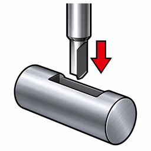

# Macro Feature – Rasgo de chaveta DIN 6885

Macro feature para SOLIDWORKS, escrita em VBA. Ela corta um rasgo de chaveta **DIN 6885-1 forma A** num eixo ou no furo de um cubo.

Diferente de uma macro comum, o resultado é uma **feature de verdade** no FeatureManager, com ícone próprio. A feature:

- **reconstrói sozinha:** se o diâmetro do eixo mudar, o rasgo é redimensionado pela norma no próximo rebuild;
- **pode ser editada:** *Editar recurso* reabre a janela com os valores salvos;
- **mostra erros como o SOLIDWORKS:** fica vermelha e explica o problema em *"O que há de errado?"*.

A inserção e a edição usam uma janela lateral (PropertyManager) no estilo do Filete, com pré-visualização do rasgo.

Testado no **SOLIDWORKS 2024 SP3.1**.

## Conteúdo do repositório

| Arquivo | O que é |
|---|---|
| `Rasgo de Chaveta.swp` | **A macro pronta.** Contém todos os módulos abaixo e a referência à biblioteca `swpublished`. É o único arquivo necessário para usar. |
| `Inserir.bas` | Módulo de entrada |
| `RasgoChaveta.bas` | Callbacks da feature e geometria |
| `PaginaRasgo.cls` | Janela do PropertyManager |
| `DIN6885.bas` | Tabela da norma |
| `RasgoArvore_*.bmp` | Ícones da feature na árvore: 20, 32 e 40 px, cada um nos estados normal, `_suprimido` e `_realce` |
| `RasgoChaveta_20/32/40.bmp`, `rasgo_de_chaveta.bmp` | Ícones para o botão da barra de ferramentas |
| `Rasgo.svg` | Desenho original dos ícones |
| `icones.ps1` | Gera todos os bitmaps a partir do `Rasgo.svg` (requer Inkscape) |

Os `.bas` e `.cls` são cópias exportadas da macro. Servem para ler o código e acompanhar as mudanças no Git; para usar, basta o `.swp`.

## Módulos

### `Inserir.bas`: ponto de entrada

- **`main()`** é o procedimento chamado pelo botão ou por *Executar macro*. Ele verifica se há uma peça aberta e abre a janela de inserção. Se uma face cilíndrica já estiver selecionada, ela entra preenchida.
- **`InserirFeature(...)`** é chamado quando você confirma a janela (✓). Ele:
  1. valida a geometria;
  2. grava as referências (face = marca 1, plano = marca 2) e os parâmetros;
  3. cria a feature com `FeatureManager.InsertMacroFeature3`, passando os 9 ícones da árvore;
  4. dá à feature um nome com a designação, por exemplo `Rasgo DIN 6885 A 8x7x36`.
- **`EMBUTIR_MACRO`**: com `True`, o código da macro é gravado dentro de cada peça e a feature funciona em máquinas que não têm o `.swp`.

### `RasgoChaveta.bas`: a feature

- **Callbacks que o SOLIDWORKS chama:**
  - `swmRebuild`: a cada reconstrução, recalcula o rasgo e corta o corpo.
  - `swmEditDefinition`: em *Editar recurso*, abre a janela de edição.
  - `swmSecurity`: liberação da feature.
- **Parâmetros:** guardados na própria feature (`ParamsRasgo`). São eles:
  - modo: detectar, eixo ou cubo;
  - b e t automáticos ou manuais;
  - comprimento;
  - referência de posição: início, centro ou fim;
  - distância;
  - ângulo.

  Funções de apoio: `LerParametros`, `GravarParametros` e `ParametrosTipados`.
- **Geometria:**
  - `CalcularRasgo` e `CalcularDeObjetos` encontram o eixo da face cilíndrica, o diâmetro, a extensão da face e a orientação.
  - `FaceEhFuro` decide entre eixo e cubo usando as normais da tesselação.
  - `ConstruirFerramenta` monta o corpo de corte com o `IModeler`: forma A com pontas arredondadas no eixo, rasgo passante com t2 no cubo.
- **Utilidades:** `SelecionarObjeto`, `Renomear` e `Log`. Com `DEPURAR = True`, o log é gravado em `%TEMP%\RasgoChaveta.log`.

### `PaginaRasgo.cls`: janela do PropertyManager

Esta classe implementa `PropertyManagerPage2Handler9` e é usada tanto na inserção (`AbrirInsercao`) quanto na edição (`AbrirEdicao`).

- **Grupos da janela:**
  - Referências: face cilíndrica e plano de orientação.
  - Aplicar em: Detectar, Eixo ou Cubo.
  - Dimensões: automático pela norma ou manual.
  - Posição: referência, distância, comprimento, ângulo e *Inverter lado*.
- **Atualização:** a cada mudança, `Atualizar` recalcula a designação e desenha a pré-visualização em laranja (`Body2.Display3`).
- **Ao fechar:** no ✓, a classe insere a feature ou aplica a edição (`ModifyDefinition`). No ✗, descarta.

### `DIN6885.bas`: a norma

- **`BuscarDIN6885(d, b, h, t1, t2)`**: dimensões da chaveta e do rasgo para diâmetros de 6 a 230 mm.
- **`ComprimentosPadrao` / `SugerirComprimento`**: comprimentos padronizados. A sugestão é o comprimento padrão mais próximo de 1,5·d que caiba na face.

## Instalação

1. Baixe o repositório (*Code › Download ZIP* ou `git clone`) para uma **pasta fixa**, por exemplo `C:\Macros\RasgoChaveta`.
   > As features gravadas nas peças guardam o caminho do `.swp`. Se a pasta for movida, as features existentes deixam de reconstruir até que o arquivo volte ao lugar.
2. Os ícones da árvore precisam estar na mesma pasta do `.swp`. Se faltarem, a feature usa o ícone padrão de macro feature.

### Botão na aba Recursos (opcional)

1. **Ferramentas › Personalizar…**, aba **Comandos**, categoria **Macro**.
2. Arraste o ícone de *botão de macro personalizado* para a aba **Recursos** do CommandManager.
3. Preencha os campos:
   - **Imagem:** `RasgoChaveta_20.bmp`
   - **Dica:** `Rasgo de chaveta DIN 6885`
   - **Macro:** `Rasgo de Chaveta.swp`
   - **Método:** `Inserir.main`

## Como usar

1. Abra uma peça e, se quiser, selecione a face cilíndrica do eixo ou do furo.
2. Clique no botão, ou use **Ferramentas › Macro › Executar…** e escolha `Rasgo de Chaveta.swp`.
3. Ajuste na janela:

   | Grupo | O que faz |
   |---|---|
   | **Referências** | Face cilíndrica (obrigatória) e, opcionalmente, um plano ou face plana que contenha o eixo. O rasgo fica do lado da normal desse plano. |
   | **Aplicar em** | *Detectar automaticamente*, *Eixo* (rasgo fechado, pontas arredondadas) ou *Cubo* (rasgo passante no furo, profundidade t2) |
   | **Dimensões** | *Automático pela DIN 6885* (b e t calculados e mostrados) ou *Manual*. A designação aparece embaixo, ou o motivo do erro. |
   | **Posição** | Referência (início / centralizado / fim), distância da extremidade, comprimento padrão automático (~1,5·d) ou manual, ângulo em torno do eixo e **Inverter lado (180°)** |

4. Confirme com **✓**. A feature aparece na árvore, por exemplo `Rasgo DIN 6885 A 8x7x36`.
5. Para alterar depois, use **Editar recurso** na feature.

### Exemplo

Eixo Ø25 × 100 mm:

1. Insira o rasgo: fica `8x7x36`.
2. Mude o diâmetro do esboço para Ø40 e reconstrua (Ctrl+B). O rasgo passa a `12x8x63` sozinho.
3. Encurte o eixo até a chaveta não caber. A feature fica vermelha e explica o problema.

## Notas técnicas

- `InsertMacroFeature3` exige **arrays tipados** (`String()` / `Long()`). Com `Array(...)` a feature não é criada.
- No PropertyManager em VBA:
  - Os **grupos** precisam ficar em variáveis da classe. Se forem locais, o VBA os libera e a página aparece vazia, ou o SOLIDWORKS trava.
  - Não altere valores de controles em `AfterActivation`; a primeira atualização é feita logo após `Show`.
  - Não use um laço `DoEvents` para manter a página aberta. A variável global já basta.
  - Conversões para `PropertyManagerPageControl` (`Enabled`, `SetStandardPictureLabel`) travaram o SOLIDWORKS 2024. Por isso os campos ficam sempre editáveis.
- **Ícones da árvore:** são 9 bitmaps (normal, suprimido e realçado × 20, 32 e 40 px), gravados com o caminho na feature. O SOLIDWORKS guarda os ícones em cache, então só mostra bitmaps trocados depois de reiniciado.
- **Edição dos fontes:** `.bas` e `.cls` precisam estar em Windows-1252 com CRLF para importar no editor VBA. O `.gitattributes` converte esses arquivos automaticamente.

## Limitações

- Não há tolerâncias de ajuste (P9/N9/JS9) como propriedade nem cota de comprimento arrastável na tela.
- Features inseridas com versões antigas da macro, sem ícones, mantêm o ícone padrão. Reinsira a feature para ter o ícone novo.

## Licença

Veja [LICENSE](LICENSE).
