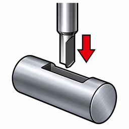

# Macro Feature – Rasgo de chaveta DIN 6885

Macro feature em VBA para SOLIDWORKS. Ela corta um rasgo de chaveta **DIN 6885-1 forma A** num eixo ou no furo de um cubo.

O rasgo vira uma feature na árvore, com ícone próprio. Ele é redimensionado pela norma quando o diâmetro muda e pode ser editado numa janela do PropertyManager, com pré-visualização.

**Uso rápido:**

1. Baixe o repositório para uma pasta fixa.
2. Abra uma peça e selecione a face cilíndrica.
3. Vá em **Ferramentas › Macro › Executar…** e escolha `Rasgo de Chaveta.swp`.
4. Use, copie e distribua. Se puder citar o Autor, agradecemos!
5. Se houver boa receptividade, vamos fazer um tutorial de como fazer esse tipo de Macros, quais ferramentas usar e o caminho das pedras.

📖 **Documentação completa (módulos, instalação, uso e notas técnicas): [Leiame.md](Leiame.md)**
